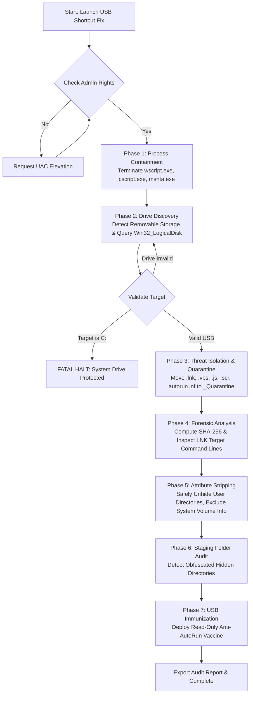

# 🛡️ USB Shortcut Fix & Data Recovery Suite

[](https://github.com/aseerawsaf45-dev/usb-shortcut-fix)
[](https://github.com/aseerawsaf45-dev/usb-shortcut-fix)
[](LICENSE)
[](https://github.com/aseerawsaf45-dev/usb-shortcut-fix)

> **Enterprise-grade remediation toolkit designed to safely eradicate USB Shortcut Malware (Houdini, njRAT, Ramnit, AutoRun worms), unhide quarantined files and folders, perform cryptographic forensic analysis, and immunize external storage.**

---

## ⚡ At a Glance

The **USB Shortcut Virus** (also known as the *1-byte shortcut worm* or *Houdini/VBS dropper*) infects removable flash drives, converts all original directories and files into `.lnk` shortcut files, sets the original data attributes to **System + Hidden**, and launches malicious script engines (`wscript.exe`, `cscript.exe`, or `mshta.exe`) whenever a user attempts to open their folders.

Most internet scripts use dangerous one-liners like `attrib -h -r -s /s /d *.*` and `del *.lnk`, which can:
- **Brick your Windows operating system** if accidentally pointed to `C:\`.
- **Halt or crash** on locked OS directories like `System Volume Information` and `$RECYCLE.BIN`.
- **Permanently destroy evidence or legitimate shortcuts** without creating a quarantine backup.
- **Fail to extract files** that malware moved into hidden staging folders (e.g. `\ \`, `\_`, or UUID directories).

**USB Shortcut Fix** solves this with an industrial, failsafe architecture available in both zero-dependency **Batch** and advanced **PowerShell** formats.

---

## 🏗️ Architecture & Remediation Flow



---

## 🚀 Key Features & Enterprise Optimizations

| Feature | Standard Internet Scripts | **USB Shortcut Fix Suite** |
| :--- | :---: | :---: |
| **System Drive Protection** | ❌ None (can wipe C:\) | ✅ **Hard-block guardrail prevents execution on `%SystemDrive%`** |
| **UAC Auto-Elevation** | ❌ Manual right-click required | ✅ **Automatic seamless elevation to Administrator** |
| **Removable Drive Discovery** | ❌ Manual guess | ✅ **CIM / WMI automated scan displaying labels, size & file system** |
| **Non-Destructive Quarantine** | ❌ Permanent `del /f /q` | ✅ **Isolated into timestamped `_Quarantine` folder before cleanup** |
| **Protected Directory Skip** | ❌ Crashes on `System Volume Info` | ✅ **Intelligently ignores locked OS system folders** |
| **Malware Staging Detection** | ❌ Ignores hidden subfolders | ✅ **Scans for obfuscated root containers (e.g. `_`, spaces, GUIDs)** |
| **Forensic LNK & Hash Audit** | ❌ None | ✅ **Extracts command-line targets & computes SHA-256 checksums** |
| **Storage Immunization** | ❌ None | ✅ **Creates write-protected, un-deletable `autorun.inf` vaccine** |
| **Dry Run / Simulation** | ❌ None | ✅ **Supports `-ScanOnly` audit mode via PowerShell** |

---

## 🛠️ Usage Instructions

### Method 1: Instant Fix (Batch — Zero Dependencies)
1. Plug in your infected USB flash drive.
2. Double-click **[`USB_Shortcut_Fix.bat`](USB_Shortcut_Fix.bat)**.
3. Accept the Windows UAC elevation prompt.
4. Select your USB drive letter (e.g., `E`).
5. Let the script automatically quarantine threats, unhide files, and install the immunization vaccine.

### Method 2: Advanced Forensic Remediation (PowerShell)
For IT administrators, security analysts, and incident responders:

```powershell
# Run full remediation with automatic USB detection and verbose JSON forensics
powershell -ExecutionPolicy Bypass -File .\USB-Shortcut-Fix.ps1 -AutoSelectUSB -VerboseReport

# Remediate a specific drive (e.g., F:)
powershell -ExecutionPolicy Bypass -File .\USB-Shortcut-Fix.ps1 -DriveLetter F:

# Perform a non-destructive read-only forensic audit (Dry Run)
powershell -ExecutionPolicy Bypass -File .\USB-Shortcut-Fix.ps1 -DriveLetter E: -ScanOnly
```

### Method 3: Master Launcher
Double-click **[`Run_Remediation.cmd`](Run_Remediation.cmd)** to choose between Fast Batch mode, Forensic PowerShell mode, or Audit mode via a simple interactive menu.

---

## 🔬 Threat Model & How the Virus Works

```
[Infected PC] 
      │
      ├─► Scans connected removable drives
      ├─► Sets all user files & folders to: Hidden (+H) & System (+S)
      ├─► Creates matching *.lnk files with user folder icons:
      │       Target: "cmd.exe /c start wscript.exe payload.vbs & explorer.exe original_folder"
      └─► When clicked on a clean PC:
              ├─► Executes malware payload (re-infects the clean PC)
              └─► Opens original folder to deceive user
```

### Disarmed File Types:
- `.lnk` — LNK shell shortcut droppers
- `autorun.inf` — Legacy Windows AutoRun configuration files
- `.vbs` / `.vbe` — VBScript / Encoded VBScript malware
- `.js` / `.jse` — JScript malware droppers
- `.wsf` — Windows Script File containers
- `.scr` — Disguised screensaver executables
- `.hta` — HTML Application payload droppers

---

## 📋 Forensic Audit Report Sample

After remediation, a report (`USB_Remediation_Report_<TIMESTAMP>.txt`) is generated directly on the target drive:

```text
================================================================================
USB SHORTCUT VIRUS INCIDENT & RECOVERY AUDIT LOG
Generated By: USB Shortcut Remediation Suite v3.2.0 (PowerShell)
Date / Time : Friday, October 23, 2026 10:16:40 AM
Target Root : E:\
Execution   : Full Remediation
================================================================================

[SUSPICIOUS THREATS ENCOUNTERED: 2]

File Name   : Documents.lnk
Path        : E:\Documents.lnk
SHA-256     : 8b1a9953c4611296a827abf8c47804d7...
LNK Target  : C:\Windows\System32\wscript.exe
LNK Args    : //B //nologo E:\_helper.vbs

File Name   : _helper.vbs
Path        : E:\_helper.vbs
SHA-256     : 4f53cda18c2baa0c0354bb5f9a3ecbe5...
LNK Target  : 
LNK Args    : 

--------------------------------------------------------------------------------
[RESTORATION SUMMARY]
Root Files Processed       : 14
Directories Restored       : 6
Quarantine Path            : E:\_Quarantine_20261023_101640
Immunization Installed     : Yes
--------------------------------------------------------------------------------
```

---

## 🛡️ Post-Remediation Security Checklist

Remediating the USB drive is only step 1. If your USB was infected, the host machine you previously plugged it into is likely compromised. Perform the following checks:

1. **Scan Host PC with Microsoft Defender Offline:**
   - Go to `Windows Security` -> `Virus & threat protection` -> `Scan options`.
   - Select **Microsoft Defender Antivirus (offline scan)** and restart.
2. **Inspect Startup Items:**
   - Press `Ctrl + Shift + Esc` -> open **Startup apps**.
   - Disable any suspicious entries referencing `wscript.exe`, `powershell.exe -enc`, or random `.vbs` files.
3. **Inspect Scheduled Tasks:**
   - Run `taskschd.msc` and inspect the Task Scheduler Library for rogue tasks executing scripts from `%AppData%` or `%Temp%`.
4. **Inspect Registry Autostart Hooks:**
   - Inspect: `HKCU\Software\Microsoft\Windows\CurrentVersion\Run`
   - Inspect: `HKLM\Software\Microsoft\Windows\CurrentVersion\Run`

---

## 🤝 Contributing

Contributions, bug reports, and pull requests are warmly welcomed!
1. Fork this repository.
2. Create a feature branch (`git checkout -b feature/enhancement`).
3. Commit your changes (`git commit -m 'Add new dropper detection pattern'`).
4. Push to the branch (`git push origin feature/enhancement`).
5. Open a Pull Request.

---

## 📄 License

This project is open-source software licensed under the **[MIT License](LICENSE)**.
Free for personal, corporate, and educational use.
